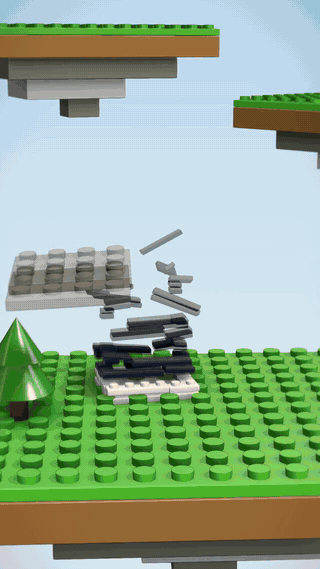
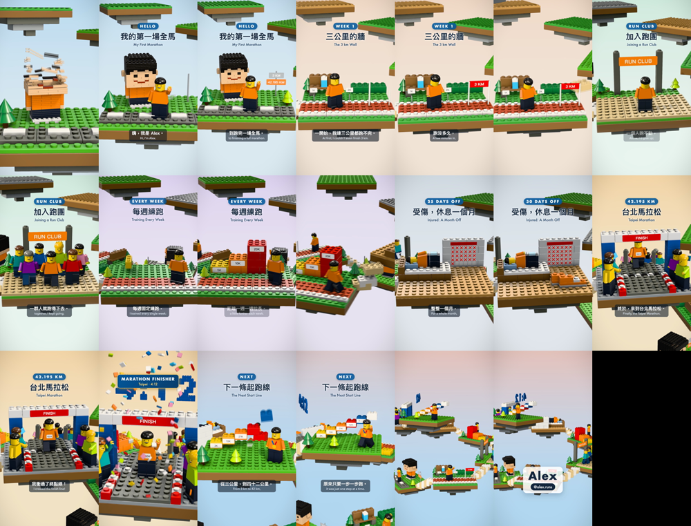
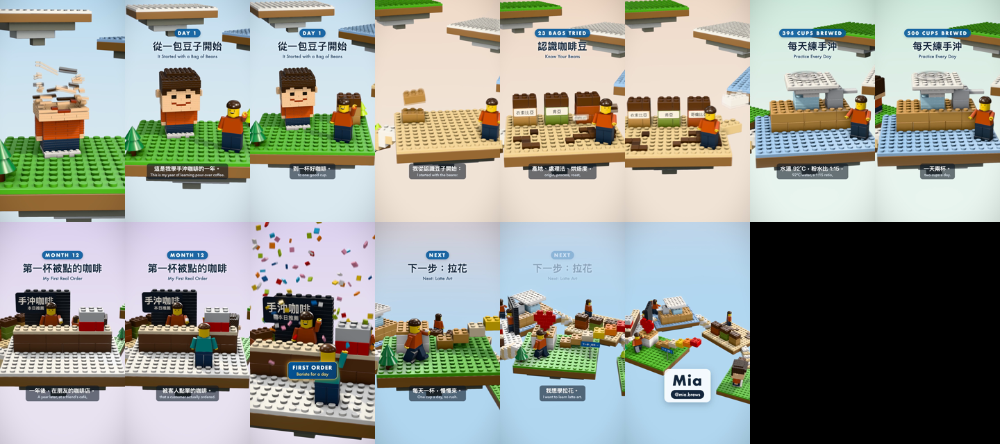

# brick-story

**Turn any story into a 3D brick-diorama video — by talking to your AI agent.**

Every chapter becomes a floating brick island. Bricks drop in and snap together while a narrator tells the story, stairs build between islands as the camera climbs a spiral, the climax gets confetti and a music drop, and the ending pulls back over the whole journey.

<p align="center">
  
  <br />
  <a href="https://github.com/chyiiiiiiiiiiii/brick-story/releases/download/v0.1.0/brick-story-first-marathon-1080p60.mp4"><b>▶ Watch the full video (61 s, 1080p 60 fps)</b></a>
</p>

Everything is generated by code: the 3D (Remotion + Three.js), the original music and every sound effect (numpy), the subtitles, and the mastering. No stock footage, no samples, no video model.

## Use it

1. Install it as a skill (Claude Code shown; any agent that can read a markdown file and run a shell works):

   ```bash
   git clone --depth 1 https://github.com/chyiiiiiiiiiiii/brick-story ~/.claude/skills/brick-story
   ```

2. Ask for a video in plain words:

   > Use brick-story to make a vertical video about my year of learning to bake bread. Chinese narration with English subtitles, end on this photo.

The agent then:

- asks what it is missing (at most five questions);
- writes the story and designs one island per chapter;
- generates the narration and checks the pronunciation by listening back;
- previews frames, fixes what reads badly, and renders.

You get `video.mp4` (1080×1920, 60 fps, loudness-normalised), `.srt` subtitles and text-free covers. Want a change? Say it: "make the third island a bakery", "slower narration", "English only".

Not using Claude Code? Point your agent at [`SKILL.md`](SKILL.md). It is the whole workflow in plain markdown.

## Made from one sentence

To test the skill, a fresh agent that had never seen this code got only `SKILL.md` and this request:

> 用 brick-story 幫我做一支直式影片，講我第一次跑完全程馬拉松的故事：從連 3 公里都跑不完，到加入跑團、每週練跑、受傷休息一個月、最後在台北馬拉松 4 小時 12 分完賽。中文旁白、中英字幕。結尾放我的名字 Alex，帳號 @alex.runs。

It wrote the story, designed and built seven islands, and rendered the whole video on its own in 61 s. The islands are a running track with a "3 KM" wall, a run club filling in, weekly distance towers, an injury calendar crossing off 30 days, and a finish arch Alex runs through as "4:12" lands on the music drop. Its files are in [`examples/first-marathon/`](examples/first-marathon). **▶ [Watch it (1080p, 61 s)](https://github.com/chyiiiiiiiiiiii/brick-story/releases/download/v0.1.0/brick-story-first-marathon-1080p60.mp4)**



## What's inside

| Path | What |
|---|---|
| [`SKILL.md`](SKILL.md) | the workflow the agent follows, step by step, with a done-condition for each step |
| [`reference/`](reference) | `story.json` format, the scene API with recipes, the style bible (every look and motion decision, with its parameters), troubleshooting |
| [`template/`](template) | the engine plus a 5-scene demo story ("my year of pour-over coffee"); the agent copies this per video |
| [`examples/first-marathon/`](examples/first-marathon) | the one-sentence test above: 7 islands, made entirely by an agent following `SKILL.md` |
| [`examples/yii-journey/`](examples/yii-journey) | the video that started this: 11 islands of a developer's journey (scene code only) |

**Demo** (`template/`, 43 s): **▶ [watch it](https://github.com/chyiiiiiiiiiiii/brick-story/releases/download/v0.1.0/brick-story-coffee-demo.mp4)**. All videos are on the [release page](https://github.com/chyiiiiiiiiiiii/brick-story/releases/tag/v0.1.0).



## The look, briefly

- **Bricks**: real brick proportions, soft bevels, glossy plastic. Instanced, so thousands of bricks stay fast.
- **Assembly**: every brick drops, eases and snaps, and every landing is a click in the soundtrack.
- **Light**: ambient occlusion, a custom seam-line shader and soft shadows, with neutral tone mapping and tilt-shift.
- **Camera**: one Gaussian-smoothed move through the whole video, rendered at 120 fps and blended to 60 fps for motion blur.
- **Music**: an original track whose drop lands on the climax frame; the narration ducks the music and the effects.

The details and the reasons are in [`reference/style.md`](reference/style.md).

## Requirements

macOS (tested) with Node 18+, Python 3.9+ and ffmpeg (`brew install node python ffmpeg`). Linux should work with small font and GL tweaks (see `reference/troubleshooting.md`). A 60-second video renders in 5–10 minutes on an Apple-silicon Mac.

## 中文說明

**用說的，把任何故事變成一支 3D 積木小島影片。**

故事的每一章是一座浮空積木島。旁白講到哪裡，積木就從上方落下、「喀」一聲卡上。島與島之間的階梯一階一階蓋起來，鏡頭沿螺旋往上爬；高潮時彩帶爆開、音樂 drop，最後拉遠看見整條路。

- **安裝**：`git clone --depth 1` 到 `~/.claude/skills/brick-story`。
- **使用**：對 Agent 說「用 brick-story 做一支關於＿＿的直式影片，中文旁白、英文字幕，結尾放這張照片」。
- **Agent 會做的事**：
  - 問你缺的資訊，最多 5 題。
  - 寫故事、設計每座島。
  - 生成旁白，並回聽檢查發音。
  - 先抽幾格畫面預覽，修正後再渲染。
- **修改**：一樣用自然語言。

影片：[全馬完整版](https://github.com/chyiiiiiiiiiiii/brick-story/releases/download/v0.1.0/brick-story-first-marathon-1080p60.mp4)、[所有影片](https://github.com/chyiiiiiiiiiiii/brick-story/releases/tag/v0.1.0)。

範例：`examples/first-marathon` 是一個全新 Agent 只憑一句話做出的全馬故事；`examples/yii-journey` 是 Yii 的開發者之路（只有場景程式碼）。

## Credits and notes

- **Origin**: created by [Yii Chen](https://github.com/chyiiiiiiiiiiii) with Claude, from the video in `examples/yii-journey`.
- **Narration**: uses [edge-tts](https://github.com/rany2/edge-tts), which calls Microsoft Edge's online read-aloud service; check that its terms fit your use, or record your own voice. Drop your own 48 kHz mono WAVs into `audio/voice/` and the timeline follows their lengths.
- **Trademarks**: "brick" here means the generic toy-brick style. This project is not affiliated with or endorsed by the LEGO Group.
- **License**: MIT.
