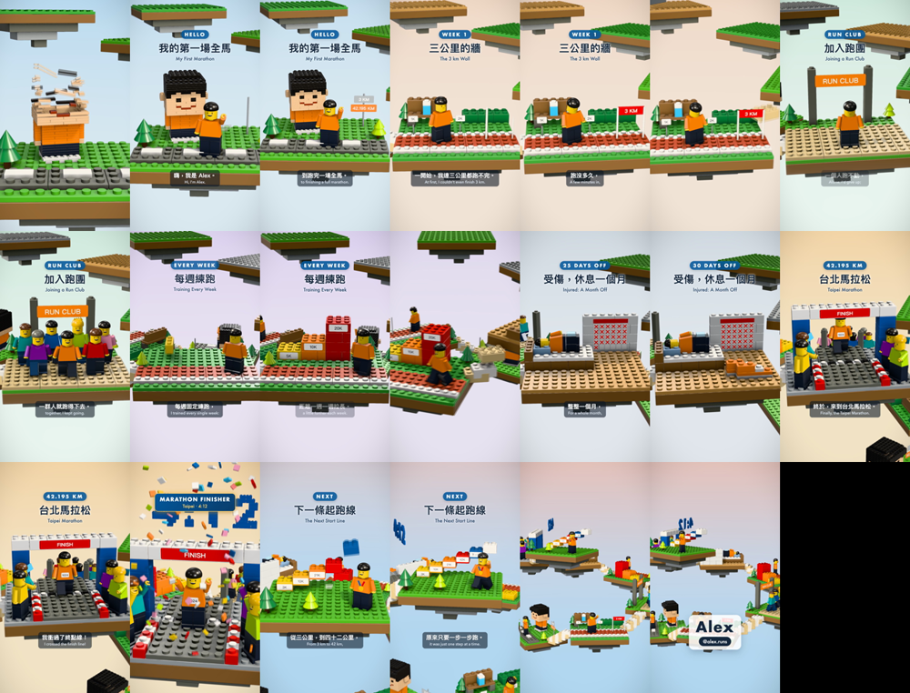

# Example: 我的第一場全馬 (first marathon)

Made end to end by an agent that had never seen brick-story, from `SKILL.md` and one request:

> 用 brick-story 幫我做一支直式影片，講我第一次跑完全程馬拉松的故事：從連 3 公里都跑不完，到加入跑團、每週練跑、受傷休息一個月、最後在台北馬拉松 4 小時 12 分完賽。中文旁白、中英字幕。結尾放我的名字 Alex，帳號 @alex.runs。

The agent couldn't ask questions, so it assumed a hero with short black hair and an orange tee, no photo, and the finish line as the climax.

Things to borrow from it:

- **A goal that grows**: a signpost pops "3 KM" and then "42.195 KM" (`hello.tsx`).
- **A figure that stops short**: a hero jogs, then stops before the 2K post, bent over (`start.tsx`).
- **Joining a group**: club mates drop in one by one, then everyone jogs together (`club.tsx`).
- **A bar chart in bricks**: 5K, 10K and 20K towers land as each number is spoken (`train.tsx`).
- **Time passing**: a 30-day calendar crosses off days in step with the "DAYS OFF" counter (`injury.tsx`).
- **Running through the finish**: the hero runs through the arch toward the camera while "4:12" lands on the music drop (`race.tsx`).
- **An ending that points forward**: a staircase labelled 3K → 42K → 下一場 (`next.tsx`).

Run it the same way as any story: copy `template/`, replace `story.json` and `src/scenes/` with these files, then `zsh scripts/make.sh`.
